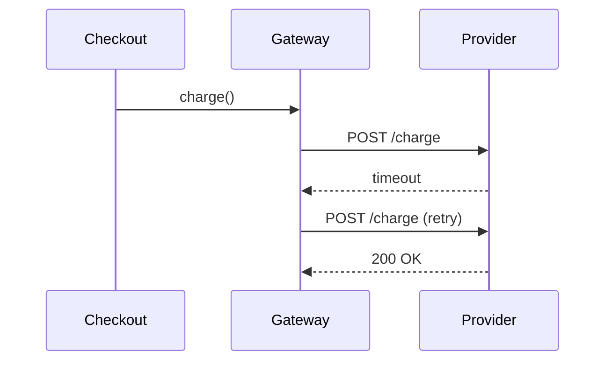

# Change Outline Views

Pick the smallest view that shows the shape of the change. Keep only the tables, calls, files, props, and states a reviewer needs. Order views so the story is easiest to follow; for example, show a new type before the code that uses it. Both GitHub and GitLab render Mermaid.

- Use `diff` when the surrounding shape already exists and the point is what changed.
- Show the complete shape in a language or `text` block when most of it is new or a diff would hide order or ownership.

## Schema or API contract

```diff
 orders
   id
   status
+  retry_count  int  default 0
```

## Key type

```ts
type RetryOptions = { attempts: number; backoffMs: number }
```

## Logic as pseudocode

```diff
 on(request)
-  send request
+  for each attempt
+    send request
+    if timeout or 5xx, wait backoffMs and retry
+    else return response
```

## File layout

```diff
 src/
 ├── http/
+│   └── retry.ts        # retry loop and backoff
 └── payments/
     └── gateway.ts      # enables retries for charge()
```

## Component tree

```diff
 <CheckoutPage>
   useCart()
   <PaymentForm>
+    <RetryNotice />     (packages/ui)
```

## Call tree

```diff
 placeOrder
   PaymentGateway.charge
-    HttpClient.request
+    HttpClient.request({ retry })
+      withRetry
```

## Interaction or data flow


